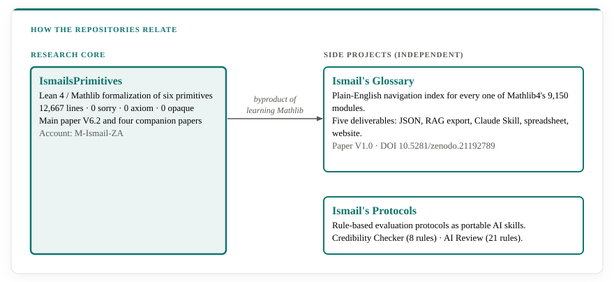
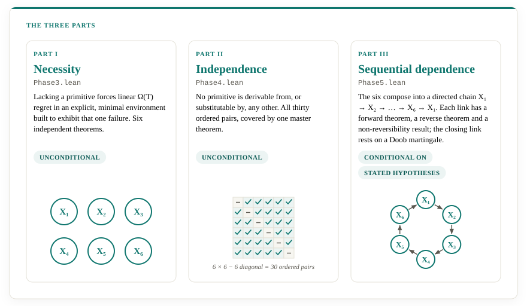
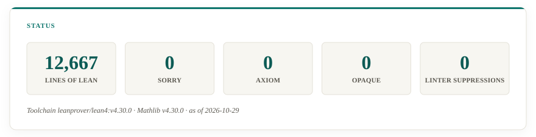

# Muhammed Ismail

**Theoretical Mathematician · Formal Verification · Decision Theory Under Uncertainty**

[](https://github.com/M-Ismail-ZA)
[](https://orcid.org/0009-0000-3713-7105)
[](https://www.linkedin.com/in/researcher-adaptationtheory/)
[](mailto:literacity@outlook.com)
[](https://doi.org/10.5281/zenodo.23080967)

[](https://decisional-integrity.github.io/Field/)

---

## Overview

I am a theoretical mathematician working at the intersection of formal verification, decision theory under uncertainty, and cross-domain structural translation. My work is organized around a single core question: **What must a decision-maker get right, structurally, to avoid failure under uncertainty?** This is explored, expanded, and answered by my Lean 4/Mathlib formalization — **Ismail's Primitives** — that proves six structural properties necessary, mutually independent, and sequentially dependent for adaptive decision-making in a precisely defined environment class (Class C). That formalization is then instantiated across four domains: economics, developmental psychology, clinical psychology, and a clinical protocol (SPEA). A separate repository, **Ismail's Glossary**, provides a complete navigation index for every module in Mathlib4. A third repository, **Ismail's Protocols**, packages independent rule-based evaluation protocols — for source/claim credibility and AI-writing review — as portable AI skills, each with its own citation trail rather than a formal proof.

All mathematical results are machine-checked in Lean 4 against Mathlib. The formalization contains **zero `sorry`**, **zero custom `axiom`**, and **zero `opaque`** declarations. Every theorem cited in the domain papers traces to a named Lean identifier with a verifiable line range. 

---

## The ecosystem


The work sits in layers. Lean 4 and Mathlib's axioms are the foundation. The Lean
proof of Ismail's Primitives and its paper rest on them. The domain papers and
the Field of Decisional Integrity are built on the proof. Two side projects, the
Glossary and the Protocols, are independent of the theory.

Three GitHub accounts are kept separate.

| Account | Role | Holds |
|---|---|---|
| [M-Ismail-ZA](https://github.com/M-Ismail-ZA) | Research | [IsmailsPrimitives](https://github.com/M-Ismail-ZA/IsmailsPrimitives), [IsmailsGlossary](https://github.com/M-Ismail-ZA/IsmailsGlossary), [IsmailsProtocols](https://github.com/M-Ismail-ZA/IsmailsProtocols), and the papers |
| [decisional-integrity](https://github.com/decisional-integrity) | Field | [The Field of Decisional Integrity](https://github.com/decisional-integrity/Field), which rests on the proof |
| [Literacity](https://github.com/literacity) | Commercial | [Decisional assurance](https://literacity.github.io/decisional-assurance), which applies the Field's Standard as a service |

### Terminology

| Term | Meaning |
|---|---|
| Primitive (X₁–X₆) | One of six structural properties a decision-maker must possess to avoid guaranteed failure in Class C |
| Failure condition (P₁–P₆) | The structural property of an environment that the matching primitive answers |
| Class C | The environments that exhibit at least one of P₁–P₆ |
| POMDP | A partially observable Markov decision process. A proposal is distilled to one before it is assessed |
| Necessity and sufficiency | Necessity is a floor that holds in every domain. Sufficiency is a ceiling that each domain defines |
| Machine-verified, paper-proved, domain reading | How a statement can be checked: by Lean's kernel, by reading an argument in the paper, or by testing a reading of the theory against counterexamples |

---

## Where to start

| If you want to | Start here |
|---|---|
| Understand the idea in a paragraph | [Overview](#overview) |
| See the machine-checked proof | [IsmailsPrimitives](https://github.com/M-Ismail-ZA/IsmailsPrimitives) |
| Verify the proof on your own machine | [Building it yourself](https://github.com/M-Ismail-ZA/IsmailsPrimitives#building-it-yourself) |
| Know what is and isn't claimed | [The nature of the claim](#the-nature-of-the-claim) |
| Answer an objection to the theory | [Common misunderstandings](https://github.com/M-Ismail-ZA/IsmailsPrimitives/blob/main/common-misunderstandings.md) |
| Read an application to a domain | [Domain Instantiations](#domain-instantiations) |
| Assess a real decision structure | [Decisional Integrity (the Field)](#decisional-integrity-the-field) |
| Find your way around Mathlib | [IsmailsGlossary](https://github.com/M-Ismail-ZA/IsmailsGlossary) |
| Evaluate a claim or review a text | [IsmailsProtocols](https://github.com/M-Ismail-ZA/IsmailsProtocols) |

---

## Repositories

### [IsmailsPrimitives](https://github.com/M-Ismail-ZA/IsmailsPrimitives)
Machine-checked Lean 4 / Mathlib formalization of Ismail's Primitives — six structural primitives proven necessary, mutually independent, and sequentially linked for sequential decision-making under uncertainty.

- **Lines of Lean 4**: 12,667
- **sorry / axiom / opaque**: 0 / 0 / 0
- **Linter suppressions**: 0
- **Phases**: 7 interdependent files (`Phase0.lean`–`Phase5.lean` and `Phase2CMI.lean`)
- **Website**: [m-ismail-za.github.io/IsmailsPrimitives](https://m-ismail-za.github.io/IsmailsPrimitives/)
- **CI**: GitHub Actions, pinned toolchain, reproducible build

### [IsmailsGlossary](https://github.com/M-Ismail-ZA/IsmailsGlossary)
A complete navigation index for every one of Mathlib4's 9,150 modules — plain-English descriptions, systematic disambiguation of similarly named modules, and five deliverables: JSON, RAG export, Claude Skill bundle, master spreadsheet, and an interactive website.

- **Coverage**: 9,150 modules · 1,129 directories · 8,021 files · 32 top-level mathematical domains
- **Reference snapshot**: Lean 4.29.1, Mathlib4 commit `1ad783f9bf` (2026-05-09)
- **Status**: 9,107 Complete · 43 Benchmark Theorem · 0 Pending · 0 Needs Review
- **Website**: [m-ismail-za.github.io/IsmailsGlossary](https://m-ismail-za.github.io/IsmailsGlossary/)

### [IsmailsProtocols](https://github.com/M-Ismail-ZA/IsmailsProtocols)
Rule-based evaluation protocols packaged as portable Claude Skills, with porting guides for ChatGPT and Gemini: an eight-rule credibility checker for assessing whether a claim is well-supported, and a 21-rule AI-writing review adapted from Wikipedia's *Signs of AI Writing* essay.

- **Protocols**: 2 (`ismail-credibility-checker`, `ismail-ai-review`)
- **Rules**: 8 (credibility checker — 2 depth tiers, 4 severities) + 21 (AI review — 5 parts)
- **Format**: Claude Skill bundles (`SKILL.md` + `references/`), plus a platform-agnostic porting guide
- **Evidence**: every rule traces to a cited source (`references/evidence-audit.md` for the credibility checker; Wikipedia's AI-writing essay for the review)
- **License**: split — rule content CC BY 4.0, tooling/prose MIT; the AI Review rule catalog carries an additional share-alike term inherited from Wikipedia

### How the repositories relate



IsmailsPrimitives is the research core. The Glossary grew out of learning Mathlib well enough to write the proof, and it is independent of the theory. The Protocols is a second independent side project.

---

## Publications

All papers are published on Zenodo under CC BY 4.0. The foundational mathematics is the Primitives paper; the domain papers are applications of it.

| Title | Version | DOI |
|---|---|---|
| **Ismail's Primitives: A Unified Functional Theory of Necessity, Independence, and Sequential Dependence in Adaptive Decision Systems** | V6.2 (2026) | [10.5281/zenodo.23080967](https://doi.org/10.5281/zenodo.23080967) |
| **Ismail's Primitives: Lean-verified Economic Adaptation Theory** | V2.0 (2026) | [10.5281/zenodo.21289756](https://doi.org/10.5281/zenodo.21289756) |
| **Ismail's Primitives and Human Development: A Functional Isomorphism Between a Lean-Verified Computational Theory and Developmental Psychology** | V3.0 (2026) | [10.5281/zenodo.21257553](https://doi.org/10.5281/zenodo.21257553) |
| **Ismail's Primitives: An Emotional Adaptation Theory Discovered through Functional Isomorphism** | V2.0 (2026) | [10.5281/zenodo.21289914](https://doi.org/10.5281/zenodo.21289914) |
| **Ismail's Primitives: The SPEA Protocol for Clinical Psychology** | V1.0 (2026) | [10.5281/zenodo.21311895](https://doi.org/10.5281/zenodo.21311895) |
| **Ismail's Glossary: A Complete Navigation Index for Mathlib4** | V1.0 (2026) | [10.5281/zenodo.21192789](https://doi.org/10.5281/zenodo.21192789) |

---

## The Six Primitives

The formalization defines six functional properties of decision rules, referred to throughout the proof and the papers as X1–X6:

| Primitive | Name | What it requires |
|---|---|---|
| **X1** | Objective Tracking | Tell two live hypotheses apart before acting on either |
| **X2** | Cross-Context Safety Transfer | Recognize the action that can't be undone, and don't take it |
| **X3** | Global Attractor Exploration | Keep probing past the comfortable, safe plateau |
| **X4** | Policy Simplification | Commit decisively once the evidence is in |
| **X5** | Feasibility Projection | Treat a hard limit as a wall, never a trade-off |
| **X6** | Feedback Adaptation | Discard a belief once the world it described has changed |


**Part I (Necessity).** For each primitive, an explicit minimal environment is constructed and an unconditional Ω(T) regret lower bound is proved for any decision-maker lacking it.

**Part II (Independence).** For every ordered pair (i, j) with i ≠ j, an explicit decision rule is exhibited that possesses Xj but lacks Xi and suffers Ω(T) regret on the matching environment. All thirty directed-pair results follow from one master theorem.

**Part III (Sequential Dependence).** Six Information Enhancement Theorems establish that the primitives compose into a directed information chain X₁ → X₂ → ⋯ → X₆ → X₁. Each link is established by a forward theorem, a reverse theorem, and a non-reversibility result. The closing link is grounded in an explicit Doob martingale construction over cycles of play.



---

## Skills and Capabilities

| Skill | Degree | Principal artifact evidence |
|---|---|---|
| **Formal verification (Lean 4 / Mathlib)** | Advanced | 12,667-line formalization with 0 sorry, 0 axiom, 0 opaque, 0 linter suppressions; CI; seven-file dependency graph; public repository |
| **Novel argument construction** | Advanced | Six distinct lower-bound proofs (Le Cam two-world, survival-conditional, horizon-parameterized, Fano/entropy-inverse, Cesàro-average, window-calibration), plus a master independence reduction collapsing thirty pairwise results into three shared lemmas |
| **Reinforcement learning / lower-bound construction** | Advanced | Six minimal adversarial environments, six Ω(T) necessity theorems, Le Cam and Fano deployments |
| **Measure-theoretic probability** | Advanced (specific construction) | `trajMeasure` infrastructure (`oneStepKernel`, `trajMeasureAux`, `trajMeasure`) deployed as the ambient space of every downstream theorem |
| **Information theory** | Advanced (finite-alphabet decision-theoretic) | Entropy, Fano, KL/TV/JSD toolkit built from first principles and deployed in `necessity_x1` and `necessity_x4` |
| **Domain translation** | Distinctive | Four complete domain instantiations (economics, developmental psychology, clinical theory, clinical protocol) plus the Glossary's Mathlib index; each citing canonical primary sources and preserving the epistemic tier of each claim |
| **Architectural / research programme design** | Distinctive | Four-tier epistemic architecture across six interdependent documents; fourteen Phase 1 declarations positioned for downstream chain instantiation |
| **Epistemic scoping and version discipline** | Distinctive | Consistent four-tier epistemic hierarchy (machine-verified / paper-proved / domain readings / guide-invented methods); structured version histories with documented corrections |
| **Consilience argumentation** | Proficient | Erikson/Maslow/Bowlby convergence argument in developmental psychology; multiple therapeutic traditions converging on the same six functions in clinical theory |
| **Real analysis** | Proficient | `kronecker_lemma`, log-inequality chain terminating in `necessity_x4`; boundary limits for entropy-related sequences |
| **Convex analysis** | Proficient | Binary-entropy concavity and Fano monotonicity deployed via IVT-based entropy-inverse construction; Jensen's inequality for conditional expectation |
| **Stochastic processes / martingale theory** | Proficient | `cycle_filtration`, `cycle_posterior`, `azuma_hoeffding`; anchor of the closing chain link (X6 → X1) |
| **Technical writing (mathematics)** | Proficient | Paper-length mathematical exposition with formal definitions, theorem statements, proof sketches, Rosetta appendix mapping every numbered result to a Lean identifier, and environment verification appendix |
| **Domain knowledge: Economics** | Reading-level fluency | Canonical primary sources across six sub-fields (information economics, financial contagion, coordination failure, time consistency, non-convex feasibility, structural breaks); Proposition `walras`; 2008 financial crisis diagnosis |
| **Domain knowledge: Developmental psychology** | Reading-level fluency | Broad citation across stage theories, attachment theory, developmental cognitive neuroscience, philosophy of mind, cultural psychology, and computational cognitive science |
| **Domain knowledge: Clinical psychology** | Reading-level fluency | Broad citation across major psychotherapy traditions, outcome research, and emotion theory; SPEA protocol with per-step therapist scripts, falsification programme, and six study designs |
| **Software engineering** | Working | Three public repositories with clear module separation, CI, pinned toolchains, reproducible builds, and documentation |
| **Data engineering** | Working | Multi-format glossary export (JSON, RAG-ready flat export, Claude Skill bundle, spreadsheet, HTML site) with versioning discipline tracking Lean toolchain, Mathlib snapshot, and glossary release separately |
| **Rule-based protocol design (applied epistemology)** | Distinctive | Two independently built evaluation protocols — an 8-rule credibility hierarchy and a 21-rule AI-writing catalog — dependency-ordered rather than drafting-ordered, cited per rule, and ported across three AI platforms via a documented translation layer |

---

## Verification Statistics

The Lean 4 formalization underlying the Primitives paper:



Figures are as of 2026-10-29, at commit [`784bb84`](https://github.com/M-Ismail-ZA/IsmailsPrimitives/tree/784bb84). The line count covers the seven files under `SixPrimitives/`.

| Metric | Value |
|---|---|
| Lines of Lean 4 | 12,667 |
| `sorry` declarations | 0 |
| Custom `axiom` declarations | 0 |
| `opaque` declarations | 0 |
| Linter suppressions | 0 |
| Phases | 7 files (`Phase0.lean`–`Phase5.lean` and `Phase2CMI.lean`) |
| Necessity theorems | 6 |
| Independence results | 30 (via master theorem) |
| Information Enhancement Theorems | 6 |
| Closing link | Doob martingale construction over cycles |

The dependency graph is real and consumed at each phase: Phase 3 uses Phase 1/2/2CMI declarations inside its necessity proofs; Phase 4 uses Phase 2 environments inside its independence proofs; Phase 5 uses Phase 2CMI conditional-entropy machinery inside its chain-linking theorems.

---

## The nature of the claim


Every result in the IsmailsPrimitives repository is a deductive claim: *this
theorem follows from these axioms.* The proof is a closed logical object. Whether
it is correct is a question of internal consistency, and Lean's kernel decides
that definitively, so no empirical validation is needed for the theorems to hold.
What a reader can examine for themselves is what the definitions say. The
statements in `Phase0.lean` are short and [are quoted in the repository's
README](https://github.com/M-Ismail-ZA/IsmailsPrimitives#failure-conditions-and-class-c).

Part III results are conditional theorems, and they are closed logical objects
in the same way: each follows from its stated hypotheses and those axioms.

The domain papers make a different kind of claim, and each says which. The
economics paper carries Parts I–II by citation and checks Part III by hand. The
psychology papers argue by consilience and are explicitly not formal.

---

## Domain Instantiations


### Economics
[**Ismail's Primitives: Lean-verified Economic Adaptation Theory**](https://doi.org/10.5281/zenodo.21289756) (V2.0, 2026)

The same tuple of environment, algorithm, and reward is relabelled term for term as economy, coordination mechanism, and welfare. Defines C as the union of all economies satisfying at least one of six structural properties — latent preference heterogeneity (E1), irreversible catastrophic absorbing states (E2), local coordination traps (E3), uniquely optimal allocations at positive-frequency market states (E4), non-convex feasibility (E5), and structural breaks (E6). Walrasian equilibrium is recovered precisely as the special case where the environment is not in C. The 2008 financial crisis is analysed as a structural diagnostic.

### Human Development
[**Ismail's Primitives and Human Development: A Functional Isomorphism Between a Lean-Verified Computational Theory and Developmental Psychology**](https://doi.org/10.5281/zenodo.21257553) (V3.0, 2026)

Aligns the six primitives, in sequence, against three developmental traditions built from incompatible methods and foundational assumptions: Erikson's psychosocial stages (clinical psychoanalytic observation), Maslow's motivational hierarchy (humanistic psychology), and Bowlby's attachment phases (ethology and evolutionary biology). The convergence is presented as consilience in Whewell's and Wilson's technical sense — independent lines of inquiry arriving at the same structural conclusion. Eight derived testable predictions are stated.

### Clinical Theory
[**Ismail's Primitives: An Emotional Adaptation Theory Discovered through Functional Isomorphism**](https://doi.org/10.5281/zenodo.21289914) (V2.0, 2026)

Argues that human emotional life is a Class C environment and derives the six therapeutic functions that follow from it. Provides the first structural explanation of the Dodo Bird verdict: no modality dominates because the six functions are independent and irreplaceable, and integrative approaches win because they cover more of a fixed, provably complete set. Characteristic failure modes of six single-modality traditions are identified (insight without commitment, exposure non-response in alexithymia, acceptance without movement, committed-but-infeasible, activation without consolidation, discontinuous movement without direction).

### Clinical Protocol
[**Ismail's Primitives: The SPEA Protocol for Clinical Psychology**](https://doi.org/10.5281/zenodo.21311895) (V1.0, 2026)

SPEA (Six Primitives of Emotional Adaptation) is a six-step clinical sequence: Emotional Archaeology, Pattern Mapping, Emotional Imagination, Authentic Distillation, Embodied Integration, and Narrative Weaving. Each step maps onto a function that established traditions (Psychodynamic Therapy, CBT, EFT, ACT, DBT, Narrative Therapy, Motivational Interviewing, Schema Therapy) had already discovered independently. The protocol specifies treatment trajectory, self-application framework, assessment battery, contraindications, therapist competency framework, and a research programme built on five falsification criteria — necessity, independence, sequential dependence, cyclical improvement, and superiority — each paired with a study design capable of overturning it.

---

## Decisional Integrity (the Field)

Decisional Integrity is the property a structure has when, in a Class C
environment, it possesses all six primitives. The Field is the documentation for
that idea: the question, the definition, the argument, the standard for assessing
it, and the evidence that motivates it. Every theorem it uses rests on the
IsmailsPrimitives proof.

- Repository: [github.com/decisional-integrity/Field](https://github.com/decisional-integrity/Field)
- Site: [decisional-integrity.github.io/Field](https://decisional-integrity.github.io/Field/)
- The Standard, with criteria for each primitive: [Standard](https://decisional-integrity.github.io/Field/standard/standard/)
- Class C and applicability: [Class C](https://decisional-integrity.github.io/Field/field/class-c/)
- Support for each kind of claim: [verification tiers](https://decisional-integrity.github.io/Field/field/verification-tiers/)
- Where assessments can go wrong: [error theory](https://decisional-integrity.github.io/Field/field/error-theory/)
- An empirical synthesis of 26 articles on eight consulting and audit firms,
  assessed separately from the theory: [the Dossier](https://decisional-integrity.github.io/Field/dossier/)

---

## Citation

If citing the foundational mathematics:

```bibtex
@article{ismail2026primitives,
  author    = {Ismail, Muhammed},
  title     = {Ismail's Primitives: A Unified Functional Theory of Necessity,
               Independence, and Sequential Dependence in Adaptive Decision Systems},
  year      = {2026},
  publisher = {Zenodo},
  version   = {V6.2},
  doi       = {10.5281/zenodo.23080967},
  url       = {https://doi.org/10.5281/zenodo.23080967}
}
```

If citing the Glossary:

```bibtex
@article{ismail2026glossary,
  author    = {Ismail, Muhammed},
  title     = {Ismail's Glossary: A Complete Navigation Index for Mathlib4},
  year      = {2026},
  publisher = {Zenodo},
  version   = {V1.0},
  doi       = {10.5281/zenodo.21192789},
  url       = {https://doi.org/10.5281/zenodo.21192789}
}
```

If citing the Protocols repository:

```bibtex
@misc{ismail2026protocols,
  author    = {Ismail, Muhammed},
  title     = {Ismail's Protocols: Rule-Based Evaluation Protocols for Claude Skills and AI Platforms},
  year      = {2026},
  publisher = {GitHub},
  url       = {https://github.com/M-Ismail-ZA/IsmailsProtocols}
}
```

---

## Contact

- **Email**: [literacity@outlook.com](mailto:literacity@outlook.com)
- **ORCID**: [0009-0000-3713-7105](https://orcid.org/0009-0000-3713-7105)
- **LinkedIn**: [researcher-adaptationtheory](https://www.linkedin.com/in/researcher-adaptationtheory/)
- **GitHub**: [M-Ismail-ZA](https://github.com/M-Ismail-ZA)

---

## License

- **Lean formalization** (IsmailsPrimitives): MIT License
- **Papers and Glossary data**: CC BY 4.0 — free to use, cite, and build on; attribution is the only requirement.
- **Protocols**: split by kind. Rule content is CC BY 4.0. Instructional prose and tooling are MIT. The AI Review rule catalog is adapted from Wikipedia's *Signs of AI writing* and carries an additional share-alike obligation; see `LICENSE-CONTENT` in the repository.
